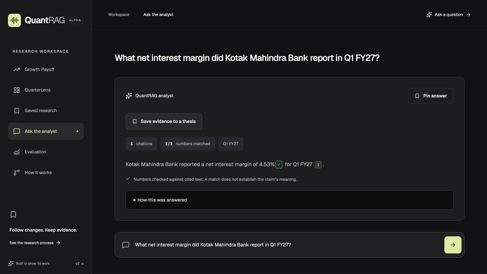
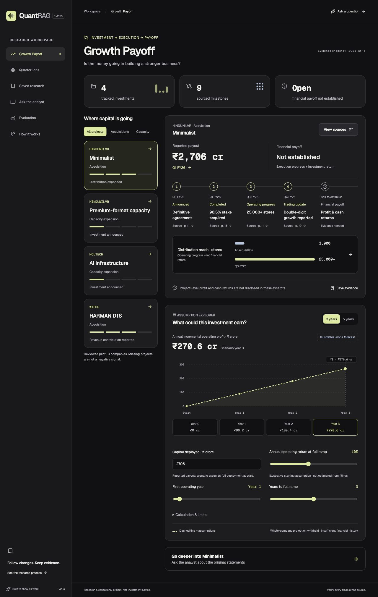
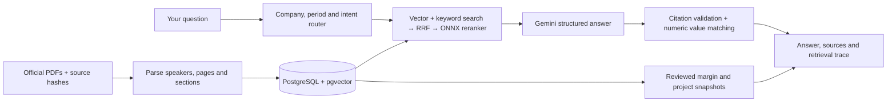

# QuantRAG

### Follow the claim. Check the number. Keep the evidence.

A financial research dashboard for understanding what companies said, what changed between quarters, and what evidence supports your view. Built for individual investors, finance students and analysts who want to check the original source.

[](https://github.com/aaranarc/earnings-call-analyst/actions/workflows/ci.yml?query=branch%3Amain)
[](https://github.com/aaranarc/earnings-call-analyst/actions/workflows/operations.yml)


**[Open the dashboard →](https://quantrag.vercel.app)** · [Ask the analyst](https://quantrag.vercel.app/ask) · [Explore Growth Payoff](https://quantrag.vercel.app/growth-payoff) · [Evaluation](https://quantrag.vercel.app/eval)



*Actual live answer captured on 18 October 2026. The API runs on free Render hosting and may need time to wake after being idle.*

## Why it exists

A company announces an investment. A later call reports progress. Another quarter brings a margin change. Those details are scattered across long PDFs, and a fluent AI summary can hide the wrong number, period or attribution.

QuantRAG brings those statements into one research workflow: **find a change → read the source → save the evidence → revisit your view.** Its focus is making company research traceable, with visual comparisons and inspectable answers.

## Highlights

- **Ask, then verify.** Ask questions about covered earnings calls, compare companies, and open citations with the original passage, speaker, quarter and PDF page. Number badges distinguish matched values, derived or elsewhere-found values, and unmatched values.
- **QuarterLens.** Favourite companies and explore sourced margin charts and quarterly changes. Reported and adjusted figures retain their accounting basis; missing quarters stay visible as gaps.
- **Growth Payoff.** Follow investment announcements through later execution milestones. Open the source behind each step, see where financial payoff remains unproven, and explore explicit three- or five-year operating-profit assumptions.
- **An evidence pile you control.** Save cited findings to research notes, build a timeline and assess whether evidence supports or challenges your idea. Export/import JSON or print a research brief. Assessments remain yours.
- **Inspect how an answer was built.** Expand the detected companies and periods, retrieval scores and latency breakdown. Unsupported questions can be refused; provider failures offer clearly dated saved examples and a retry button.

<details>
<summary><strong>See Growth Payoff: investment → execution → payoff</strong></summary>



*Dashboard captured on 16 October 2026. The dashed scenario line represents assumptions, not a validated forecast. Operational progress alone does not establish investment returns.*

</details>

## Try it

1. **[Ask the analyst](https://quantrag.vercel.app/ask):** “What net interest margin did Kotak Mahindra Bank report in Q1 FY27?” Open the citation to inspect the source.
2. **[Open QuarterLens](https://quantrag.vercel.app/watchlist):** favourite a covered company, select a quarter and inspect its margin history.
3. **[Explore Growth Payoff](https://quantrag.vercel.app/growth-payoff):** follow an acquisition or capacity project from announcement to later reported milestones.
4. **[Save your research](https://quantrag.vercel.app/research):** collect evidence and update your assessment as new information arrives. The workspace starts empty; examples are opt-in.

Favourites and research are stored in your browser, without accounts or cross-device sync. Export JSON to keep a backup.

## Coverage and evidence

The [18 October 2026 ingest snapshot](eval/results/ingest_stats.json) contains **56 official earnings-call transcripts across nine Indian companies**, indexed into **3,968 source chunks**.

| Sector | Companies |
| --- | --- |
| IT services | TCS, Infosys, HCLTech, Wipro |
| Banking | HDFC Bank, ICICI Bank, Axis Bank, Kotak Mahindra Bank |
| Consumer | Hindustan Unilever |

The registered window spans **Q2 FY25–Q1 FY27**, with uneven coverage by company. The [live coverage view](https://quantrag.vercel.app/watchlist) exposes available quarters; the [manifest](data/manifest.csv) records source URLs and SHA-256 hashes. Two supplemental HDFC earnings releases support its margin view and are registered [separately](data/results_manifest.csv).

Growth Payoff is a **reviewed pilot of four projects and nine milestones across three companies**. Follow-through currently links two TCS salary-announcement/report sequences for review. Neither feature automatically discovers or verifies every management commitment.

## How it works



| Layer | Implementation |
| --- | --- |
| Dashboard | Next.js, React, TypeScript, Geist / Geist Mono |
| API and generation | Python, FastAPI, Gemini; checked-result SSE; transient provider errors retry once (2 attempts total), the second optionally on a fallback Gemini model (`GEMINI_FALLBACK_MODEL`) |
| Retrieval | ONNX embeddings and cross-encoder reranking, PostgreSQL full-text search, reciprocal-rank fusion |
| Data | Supabase PostgreSQL / pgvector; idempotent ingestion with speaker, page and fiscal-period metadata |
| Delivery | Docker, Vercel, Render, GitHub Actions, pytest, Playwright and automated accessibility checks |

Public coverage and evaluation snapshots ship with the frontend, so browsing them does not depend on a warm API. Daily readiness checks and weekly hash-verified refreshes maintain registered sources; changed or unavailable PDFs block refresh. New sources and public snapshot deployments still require review. [Operations runbook →](docs/OPERATIONS.md)

## What is measured—and what is pending

**[Development set, not a final benchmark](https://quantrag.vercel.app/eval).** The evaluation page presents recorded retrieval and reranker-memory results from [versioned reports](eval/results/). Those historical development checks used the original, smaller corpus; they do not establish accuracy on the expanded library.

| Evidence | Where to inspect it |
| --- | --- |
| Current test status, test counts and coverage | [Latest CI runs on main](https://github.com/aaranarc/earnings-call-analyst/actions/workflows/ci.yml?query=branch%3Amain) |
| Retrieval development checks and memory measurements | [Recorded development results](eval/results/smoke_retrieval.json) |
| Corpus inventory and ingest totals | [Ingest snapshot](eval/results/ingest_stats.json) |
| Held-out retrieval, generation and judge evaluation | [Runner, review requirements and publication gates](docs/EVALUATION.md) |

The evaluation tooling is implemented, but the **human-reviewed gold benchmark and blind numeric labels remain pending**. Automated tests passing is not proof of answer faithfulness or investment-prediction accuracy.

## Run locally

The quickest way to try the product is the **[live dashboard](https://quantrag.vercel.app)**. To work on the interface locally, use Node.js 22 and npm:

```bash
git clone https://github.com/aaranarc/earnings-call-analyst.git
cd earnings-call-analyst/frontend
npm ci
npm run dev
```

Open **http://127.0.0.1:3000**. Bundled coverage and evaluation views are available without database credentials. **Live questions and research checks require the Python API, your own database and Gemini credentials.**

For the full stack, ingestion and tests, follow the **[local development guide](docs/LOCAL_DEVELOPMENT.md)**. Production configuration is in the **[deployment guide](docs/DEPLOYMENT.md)**. PDFs and credentials are not distributed with the repository.

## Boundaries worth knowing

- **Numeric matching is not semantic verification.** A value can match a passage while referring to the wrong metric, company or period. Read the citation.
- **Scenarios are not predictions.** Growth Payoff models annual incremental operating profit under visible assumptions. It does not forecast share prices, whole-company performance or success/failure probabilities, and it does not prove ROI or causality.
- **Coverage is partial.** The roadmap targets 96 transcripts across 12 Indian companies. US companies and a complete financial-statement database are not included. “Latest quarter” means the latest ingested quarter.
- **Research is local; live answers depend on services.** Browser storage can be lost, and free hosting or model providers can be unavailable. Saved example answers are dated and explicitly labelled as examples.

## Explore the project

[Local development](docs/LOCAL_DEVELOPMENT.md) · [Architecture walkthrough](docs/FLOW.md) · [Design decisions](docs/DECISIONS.md) · [Evaluation](docs/EVALUATION.md) · [Deployment](docs/DEPLOYMENT.md) · [Operations](docs/OPERATIONS.md) · [Progress and next steps](PROGRESS.md)

Built by **[Aarana Chaurasia](https://github.com/aaranarc)**. Found a misleading result, missing source or usability issue? [Open an issue](https://github.com/aaranarc/earnings-call-analyst/issues) with the question, company, quarter and supporting source. Keep credentials and personal research out of public reports.

*Research and educational software, not investment advice. Generated answers can be wrong even when cited. Verify claims against the original documents. Source transcripts belong to their respective publishers. This repository does not currently declare a software license; public availability alone does not grant unrestricted reuse.*
