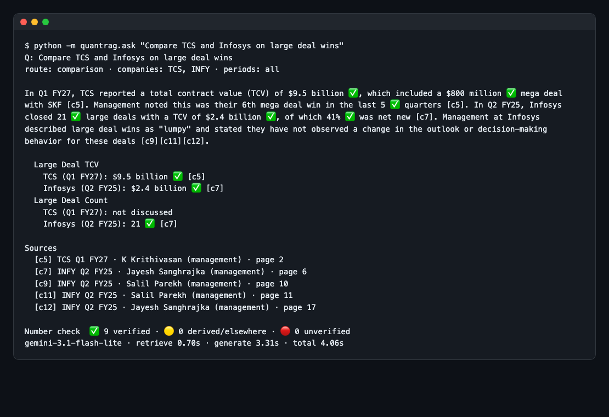
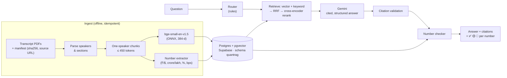

# QuantRAG

**An earnings-call analyst that cites every claim and checks every number.**

[](https://github.com/aaranarc/earnings-call-analyst/actions/workflows/ci.yml?query=branch%3Amain)


> **v2.0-alpha: a working core engine with a public roadmap.** The engine runs end to end from the command line on a
> small corpus (8 transcripts). **[Open the live dashboard](https://quantrag.vercel.app)** — free Vercel frontend and Render API. The API wakes on demand after idle periods. Every number below comes from a file in
> [`eval/results/`](eval/results/) and can be re-run.
>
> *Research and educational project. Not investment advice.*

---

## The problem

Earnings calls are where Indian companies explain their quarter: margins, deal wins, guidance, credit quality. Asking
an LLM about them has two failure modes that matter to an analyst: it **cites nothing** (so you can't check it), and it
**gets numbers subtly wrong** (₹ crore vs lakh, % vs bps, the wrong quarter). QuantRAG answers only from the transcripts,
attaches a citation to every claim, and checks every number in its own answer against the passage it cites.

## What works today

The [company watchlist](https://quantrag.vercel.app/watchlist) puts sourced quarterly changes first:
star companies, inspect operating-margin bars, open management quotes and save a change to your evidence pile.
Existing notes and thesis tools remain in [Saved research](https://quantrag.vercel.app/research).
Favourites and saved research stay in the browser; export your research to back it up.

The monitor currently extracts a narrow operating-margin vocabulary from prepared management remarks.
Its change cards quote management's stated sequential movement; gaps and excluded one-off items remain visible.
It does not infer a missed commitment, establish causality, rate a company or forecast five-year performance.
Bank/HUL calls without an unambiguous matching figure show no margin series. Snapshots refresh on ingestion,
not on a background schedule. To refresh after adding verified PDFs, run
`python scripts/build_company_monitor.py` then `python scripts/export_public_data.py` before deploying.

```bash
python -m quantrag.ask "Compare TCS and Infosys on large deal wins"
```


<sub>Output of a real run on 2026-10-15 against the Supabase database (`gemini-3.1-flash-lite`), rendered as an image.</sub>

| Step | What it does | Code |
|---|---|---|
| Corpus | 12 Indian companies × 8 quarters planned; a manifest with source links and SHA-256 per PDF; a checker with completion gates | `data/`, `scripts/check_manifest.py` |
| Ingest | PDF → speaker turns (management / analyst / moderator, prepared remarks vs Q&A) → one-speaker chunks → `bge-small` embeddings (ONNX) → Postgres + pgvector. Idempotent: re-running adds nothing | `backend/ingest/` |
| Retrieve | vector search + Postgres keyword search, fused with RRF, re-ranked by a small cross-encoder; per-company retrieval for comparisons | `backend/retrieve/` |
| Route | rule-based: companies by alias, quarters ("Q1 FY27", "last two quarters"), intent (single / comparison / risk / out of scope) | `backend/generate/router.py` |
| Answer | Gemini with structured output; every sentence cites `[cN]`; citations validated in code; refuses when the transcripts don't say, and lists what *is* available | `backend/generate/answer.py` |
| Number check | every number in the answer is looked up in the passage its sentence cites: ✅ value matched · 🟡 derived / found elsewhere · 🔴 unmatched | `backend/numcheck/` |

## Architecture



## Measured so far

Coverage reflects the current 8-transcript ingest snapshot. The other development measurements below used the
original 4-transcript corpus and are historical engineering checks, not benchmarks of the expanded corpus.
Each figure links to the file it comes from.

| What | Result | Notes | Source |
|---|---|---|---|
| Corpus in the database | **8** transcripts · **581** chunks · avg **132.6** tokens/chunk · **847** stored numbers | target is 96 transcripts | [`ingest_stats.json`](eval/results/ingest_stats.json) |
| Database size | `quantrag` schema **3.67 MB**; whole database **14.38 MB** of Supabase free's 500 MB | | [`ingest_stats.json`](eval/results/ingest_stats.json) |
| Retrieval recall@5, **dev set** | hybrid **19/20** · hybrid + rerank **18/20** (router off) → **19/20** (router on) | 20 hand-written questions written while building, not a benchmark; one label widened after seeing results (D21) | [`smoke_retrieval.json`](eval/results/smoke_retrieval.json) |
| Retrieval latency, dev set | hybrid p50 **7.4–7.7 ms**; hybrid + rerank p50 **0.43–0.46 s** | local Postgres, 3 runs | [`smoke_retrieval.json`](eval/results/smoke_retrieval.json) |
| Reranker peak memory, **macOS** | **386–419 MB** with reranking (6 runs), down from **1,116–1,191 MB** untuned; 274–285 MB with no reranker | macOS RSS is noisy; Linux not measured yet | [`smoke_retrieval.json`](eval/results/smoke_retrieval.json) |
| v1 for comparison, **macOS** | peak **171.8 MB** without reranker; **511.7–691.7 MB** with its PyTorch reranker (5 runs) | v1 effectively indexed one real transcript | [`v1_baseline.json`](eval/results/v1_baseline.json) |
| Router accuracy, original development run | **17/20** fully correct (companies 18/20, periods 19/20, intent 18/20) | Historical result before sector/latest-quarter fixes; the inspected queries now serve as regressions, not a held-out benchmark | [`router_report.json`](eval/results/router_report.json) |
| Answers with valid citations | **10/10** answerable · **3/3** unanswerable refused · **1/1** out of scope refused | automated checks; faithfulness not judged yet | [`phase4_check.json`](eval/results/phase4_check.json) |
| CI | [](https://github.com/aaranarc/earnings-call-analyst/actions/workflows/ci.yml?query=branch%3Amain) | Test counts and coverage are reported by GitHub Actions | [Latest Actions run on main](https://github.com/aaranarc/earnings-call-analyst/actions/workflows/ci.yml?query=branch%3Amain) |
| Number checker precision / recall | **TBD**: 120 numbers are waiting for blind human labels | | (`eval/results/numcheck_*.json` once labelled) |

## Known limitations

- **Small corpus.** 8 of 96 planned transcripts: TCS Q2 FY26–Q1 FY27, Infosys Q2 FY25 and Q2 FY26,
  and HDFC Bank/HUL Q1 FY27. TCS now supports four consecutive quarters and a same-quarter Q2 FY26
  comparison with Infosys. Most company/quarter combinations are still missing.
- **The dev set is not a benchmark.** It has 20 questions written during development, and one label was widened after
  seeing results. The human-verified 60-question gold set is Phase 6.
- **The number checker matches values, not meaning.** "Infosys's margin was 24%" passes if 24% is in the cited
  passage, even when the passage is about TCS. Deliberate "context swap" tests are expected to slip through (D34);
  catching them is the Phase 6 faithfulness judge's job.
- **Known failures, kept for the eval report:** the comparison above labels TCS's *total* TCV as "Large Deal TCV"
  (the number itself is right); "What was TCS's cash conversion as a share of net income?" is refused although the
  transcript says 93%; a long multi-topic CFO turn is never retrieved for palm-oil questions (D24).
- **Sector and relative-period limits:** bank / IT-services / consumer questions now select configured peers;
  an incomplete sector refuses before retrieval. "This/latest quarter" means the latest ingested quarter,
  not the current calendar quarter. Explicit fiscal periods take precedence over relative wording.
- **Memory figures are from macOS** and vary by up to ~140 MB between identical runs. Cloud Run (Linux) needs its own measurement.
- **[Public dashboard available](https://quantrag.vercel.app)** on free hosting; the API sleeps when idle. There is no weekly ingest job. The v1 code (`app/`, `models/`, `chroma_db/`) is
  still in the repo pending removal.

## Roadmap

| Step | What | Status |
|---|---|---|
| Phase 5 eval | blind-label 120 numbers; publish checker precision/recall per corruption type | labelling page ready |
| Corpus | download the remaining transcripts (gates: one per sector ✓ → latest 4 quarters → all 96) | 8/96; latest-four gate 7/48 |
| Phase 6 | 60-question human-verified gold set; cross-family judge (Groq/Llama); ablations (dense / keyword / hybrid / rerank / router); refusal threshold; failure cases | [Retrieval, generation and calibration tooling ready](docs/EVALUATION.md); human-reviewed runs pending |
| Phase 7 | FastAPI with checked-result SSE, server-only access token, daily request budget, health | implemented |
| Phase 8 | Next.js dashboard, citation drawers, number badges, retrieval trace, evaluation page | implemented |
| Phase 9 | Production images, access controls, deployment runbook; hosting and automated ingest | [deployed on Vercel + free Render](https://quantrag.vercel.app); automated ingest pending |
| Phase 10 | risk route backed by the separate distress early-warning (EWS) API | planned |
| Phase 11 | README, demo GIF, architecture write-up | planned |
| Thesis tracker | source-quoted AI suggestions, multi-period evidence timeline, manual assessment, import/export, printable brief | implemented on demand |
| Telegram bot | Optional delivery channel | deferred by owner |

Progress and the exact next steps: [`PROGRESS.md`](PROGRESS.md). Every design decision and its trade-off:
[`docs/DECISIONS.md`](docs/DECISIONS.md). How a request flows through the code: [`docs/FLOW.md`](docs/FLOW.md).
Plain-English notes: [`docs/LEARNING.md`](docs/LEARNING.md).

## Dashboard

The local dashboard adds a thesis workspace, cited Q&A, evidence drawers, number checks and retrieval traces.
[Setup and limitations](frontend/README.md). On-demand thesis checks propose exact source quotes; you review the suggestion and choose the assessment. Example scenarios are explicitly labelled. [Production setup](docs/DEPLOYMENT.md).

## Run locally

Requirements: Python 3.11, Docker (for a local Postgres), a Gemini API key.

```bash
git clone https://github.com/aaranarc/earnings-call-analyst && cd earnings-call-analyst
python3.11 -m venv .venv && .venv/bin/pip install -e "backend[dev]"
cp .env.example .env            # fill in GEMINI_API_KEY, GEMINI_MODEL, SUPABASE_DB_URL (or a local URL)

# local Postgres with pgvector (or use a Supabase project's connection string)
docker run -d --name qr-pg -e POSTGRES_PASSWORD=pg -p 127.0.0.1:5433:5432 pgvector/pgvector:pg17
#   SUPABASE_DB_URL=postgresql://postgres:pg@localhost:5433/postgres

# transcripts: PDFs are not in the repo. Download them yourself from company IR pages or exchange filings,
# save as data/raw/{SYMBOL}_Q{n}FY{yy}.pdf, fill data/manifest.csv, then:
.venv/bin/python scripts/check_manifest.py --fill-sha --gate phase2

cd backend
../.venv/bin/python -m ingest.run                       # idempotent; prints chunks, tokens, DB size
../.venv/bin/python -m quantrag.ask "What did TCS say about AI revenue?"

# tests (use a separate database: the DB tests drop the quantrag schema)
docker exec qr-pg psql -U postgres -c "create database quantrag_test"
TEST_DATABASE_URL=postgresql://postgres:pg@localhost:5433/quantrag_test ../.venv/bin/python -m pytest tests ../scripts
```

**Before you push:** this repo blocks pushes that contain secrets. Install the hook once per clone:

```bash
brew install gitleaks && git config core.hooksPath .githooks
```

It scans only the commits being pushed and fails closed if gitleaks is missing.

## Disclaimer

Research and educational project. **Not investment advice.** Answers are generated from earnings-call transcripts by a
language model and can be wrong even when cited. Check figures against the source documents. Transcripts belong to the
companies that published them; this repo stores only links and hashes, not the PDFs.
