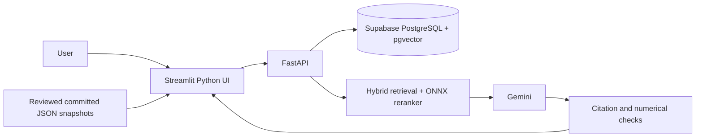

# QuantRAG — Python financial research dashboard

Ask questions about official earnings calls, inspect the source passages and numerical checks, explore quarterly margins, and track investment milestones. The interface is **Streamlit (Python)**; FastAPI owns the existing research pipeline.

[Open QuantRAG](https://quantrag.vercel.app) · [CI](https://github.com/aaranarc/earnings-call-analyst/actions/workflows/ci.yml)

The former Next.js/React/TypeScript frontend is replaced by a Python interface with the earlier charcoal-and-lime design: sidebar navigation, rounded metric cards, a source coverage grid, sector chart and compact research panels. Historical code remains in Git history. See `docs/verification` for release checks.

## Run the dashboard

Use Python 3.11. From the project root:

```bash
python3.11 -m venv .venv
source .venv/bin/activate
pip install -r ui/requirements.txt
python -m streamlit run streamlit_app.py
```

Open http://localhost:8501. Coverage, quarterly snapshots, project timelines and recorded development results work without credentials. Saved research starts empty and belongs to the current Streamlit session; export JSON before closing. There are no user accounts, shared note files, browser-storage migration or cross-device sync. JSON imports accept this Streamlit app's export format only.

## Enable live answers

In a second terminal with the same environment:

```bash
pip install -c backend/requirements-api.lock -e 'backend[api]'
cp .env.example .env
# Fill SUPABASE_DB_URL, GEMINI_API_KEY and GEMINI_MODEL in .env.
python -m uvicorn quantrag.api:app --app-dir backend --env-file .env --host 127.0.0.1 --port 8000
```

The database must contain the ingested source corpus. PDFs, database credentials and model keys are not included. Set `API_ORIGIN` if the API is remote. If `API_ACCESS_TOKEN` is configured, both Python servers must use the same value; it is never entered in the browser. Streamlit loads the root `.env` automatically. Never commit it.

## What remains

- **Ask:** cited answers, comparison tables, source excerpts/PDF links, numerical status table and retrieval/timing details.
- **QuarterLens:** favourite companies for the session; margin dots on a single selected accounting basis, reported changes and source excerpts. Missing values are not invented.
- **Growth Payoff:** reviewed investment milestones, original sources and an explicit operating-profit sensitivity chart. It is not a trained forecast or stock-price predictor.
- **Saved research:** save answers/evidence, write notes, choose an assessment, delete, export and import.
- **Evaluation:** versioned development retrieval and memory results, pending final benchmark status and the CI link. No hand-entered test count or accuracy claim.
- **Reliability:** server-side secrets, existing request budget, bounded provider retry and clearly dated saved examples after live-answer failures.

No JWT login, Redis, Kafka or artificial microservice split has been added. The Streamlit UI calls the existing API using Python HTTPX; there is no JavaScript proxy to learn.



## Tests and containers

```bash
pip install -c backend/requirements-api.lock -e 'backend[dev,api]'
pytest -c backend/pyproject.toml backend/tests scripts -q
pytest ui/tests -q
ruff check backend scripts eval --config backend/pyproject.toml
ruff check streamlit_app.py ui
# Full stack: fill .env, including a random API_ACCESS_TOKEN of at least 32 characters.
docker compose up --build
```

Compose exposes the Streamlit UI on port 8501; its API stays internal. PostgreSQL is external. Database integration tests require a separate throwaway local `TEST_DATABASE_URL` and may drop its test schema. See [local setup](docs/LOCAL_DEVELOPMENT.md).

CI now runs Python backend tests and Streamlit tests, and builds the Streamlit image. Earlier Playwright tests belonged to the removed React UI and are not presented as tests of this version. Current CI results: [Actions on main](https://github.com/aaranarc/earnings-call-analyst/actions/workflows/ci.yml?query=branch%3Amain) (check the commit on a run before associating it with a release).

## Evidence and limits

Corpus inventory comes from [the ingest snapshot](eval/results/ingest_stats.json), source registration from [the manifest](data/manifest.csv), and displayed figures from committed reports under `ui/data` and `eval/results`. Snapshots are dated, partial and not real-time market data. Human-reviewed final evaluation and blind numerical labels remain pending.

A numerical value match does not establish the right company, metric or fiscal period. Management statements are not independently audited investment conclusions. Scenario assumptions do not prove actual ROI or predict a company's future success. Review the original sources.

[Learning guide](docs/LEARNING.md) · [Request flow](docs/FLOW.md) · [Deployment](docs/DEPLOYMENT.md) · [Evaluation methodology](docs/EVALUATION.md) · [Historical implementation notes](docs/history/)
